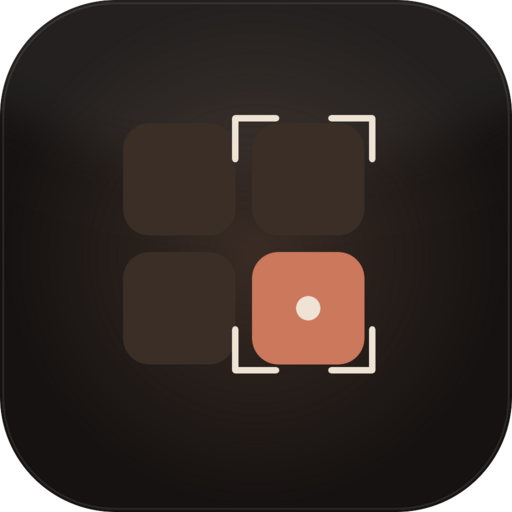
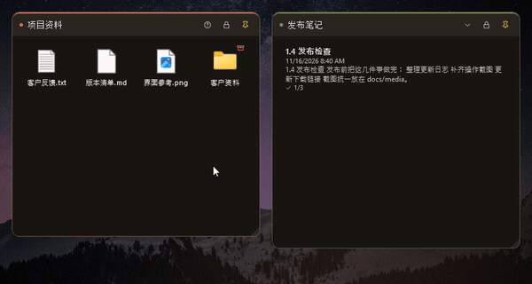
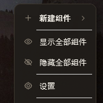
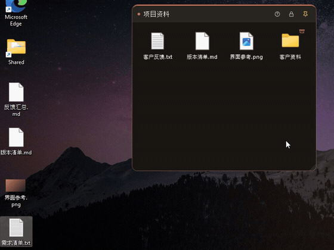
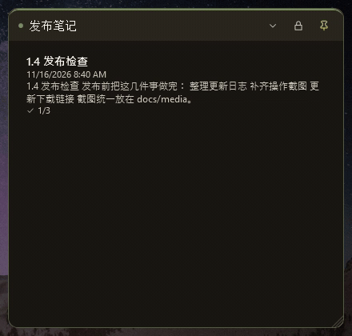
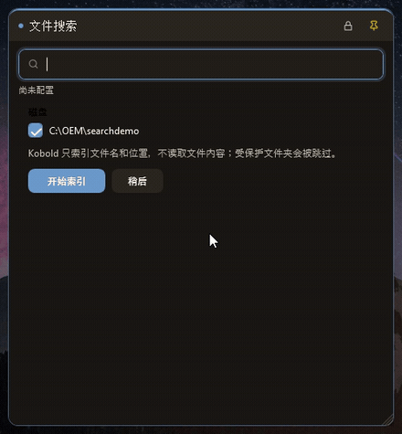
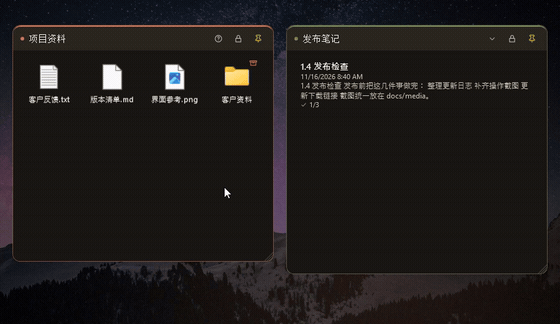
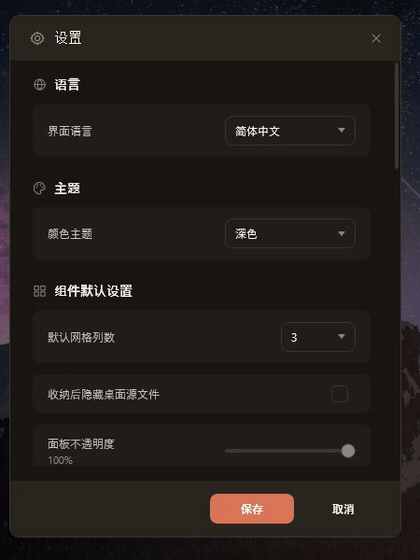

<div align="center">



# Kobold

**把桌面收进一条岛 · Put your desktop into one island**

Windows 10/11 · WPF · .NET Framework 4.8 · MIT

[English](#english) · [中文](#中文)

</div>

Kobold puts a slim **dynamic island** at the top of the screen and keeps your
files, todos and notes in floating panels below it. Hover the island, click a
tile, and the panel is there — no tray hunt, no desktop clutter.



*A folder panel and a note, one drag away from becoming a tabbed group. · 文件夹和笔记面板，拖一下即可合并成分组。*

---

## English

The recordings use the Chinese interface; the same controls are available in English under **Settings → Language**.

### Quick start

Kobold is a portable app for the current user; it needs no administrator
rights.

1. Download the latest `Kobold-v*-win-x64.zip` from [Releases](https://github.com/zzrqq-worklux/Kobold/releases), extract it anywhere and run `Kobold.exe`. Or run `tools\install.cmd` once to install it to `%LocalAppData%\Programs\Kobold` with a Start Menu shortcut and an uninstall entry.
2. On first launch the island appears at the top centre. Hover it and click **+** to add a folder, todo, note or search widget; panels you leave open come back next time.
3. The tray keeps Kobold one right-click away. The tray glyph is the simplified **K** mark; the desktop/app icon is the grouped-squares mark.




> **Tip:** the build is unsigned, so SmartScreen may warn on first run — choose **More info → Run anyway**.

### 1. Island — expand, collapse, drag

The island is the only launcher you need: hover to expand it, click a tile to
open its panel, and drag the pill to move it.

1. Move the pointer onto the slim pill at the top centre.
2. Click a widget tile to open its panel; click the tile again to close it.
3. Drag the pill sideways to reposition the island.


> **Tip:** right-click a tile for rename, colour, lock, pin and delete; the island steps aside while a fullscreen app or video is in front.

### 2. Folder panel — create, drop in, reorder

A folder panel is a shelf for files and folders: create a folder, drop things
in, then drag them into the order you want.

1. Right-click the panel's empty area → **New folder**, type a name and press Enter.
2. Drag files from the desktop into the panel; they stay where they are — the panel holds references, not copies.
3. Drag any icon onto another position to reorder it; double-click a folder to browse it in place.



> **Tip:** **Store** physically moves a file into Kobold storage; **Unstore** or **Eject** puts it back. Locked panels refuse drops.

### 3. Todo — tick, add, look at another day

The todo widget is a day planner: tick items off, add new ones in place, and
jump between dates.

1. Click a checkbox to complete an item — completed entries are struck through and sink to the bottom.
2. Click **+**, type the task and press Enter; it is added to the selected day.
3. Click a date in the calendar to see that day; the **Today** chip brings you back.


> **Tip:** Ctrl+Z undoes ticks and deletes up to 20 steps. An open item whose date has passed appears on today with a `↷ original date` badge.

### 4. Notes — Markdown editing

Notes are Markdown documents you edit in place: click a block, type, and it
renders back.

1. Click a note card to open it — the card list hides, the note fills the panel.
2. Click any block to edit its Markdown source in place.
3. Press Esc or click the blank area to render it again; click a task box to tick it.



> **Tip:** headings, lists, task boxes, quotes, code blocks, tables, emphasis and links render; right-click the source for the insert menu. There is no save button — typing is saved as you go.

### 5. Search — index once, find by name

Search finds files by name across the folders you choose; the index is built
once and kept up to date by a watcher.

1. Open the search widget and click **Start indexing**; pick the drives or folders to include.
2. Type part of a file or folder name — results appear as you type.
3. Open a result, reveal it in its folder, or copy its path from the row.



> **Tip:** only names and locations are indexed, never file contents. Pause or rebuild from the widget menu or **Settings → File search**; the index lives in `%LocalAppData%\Kobold`.

### 6. Groups — merge, reorder, detach

Groups fold several widgets into one window with tabs: merge two panels,
reorder the tabs, then split one out again.

1. Drag one panel's header onto another panel — a preview shows where it will land; release to merge.
2. Click a tab to switch widgets; drag a tab sideways to reorder it.
3. Drag a tab out of the window to detach it. A group that drops to one member dissolves by itself.



> **Tip:** lock and panel geometry belong to the group; pinning stays per member. Deleting a folder member from a group ejects its stored files first.

### 7. Settings — theme, language, start with Windows

Settings covers the look, the language, startup and the defaults for new
widgets.

1. Click the gear on the island, or choose **Settings** from the tray menu.
2. Pick a colour theme and an interface language; both apply immediately.
3. Turn on **Start with Windows**, then click **Save**.



> **Tip:** no restart is needed. Panel opacity, icon style, storage location and file-search roots live further down the same window.

**Automatic updates.** By default Kobold checks for a new release 30 seconds
after launch, then once every 24 hours. With **Install updates automatically
on exit** enabled, the package downloads and verifies in the background and
installs while the app quits; with it off Kobold only reports the offer and the
tray menu's **Update to …** entry downloads it. Nothing ever restarts the app
by surprise — a staged release can also be installed from the tray menu
(**Restart and update to …**), which is the only explicit restart. The
**Updates** card shows the current state, the two switches, **Check for
updates** and **Open download page**. Only a writable installed copy updates
itself; a portable or read-only copy just reports the offer and points at the
[download page](https://api.merrickzq.work/downloads/kobold/). A failed swap
restores the backup and starts the previous version. There is no code signing:
the package arrives over HTTPS from a fixed host and is verified by SHA-256,
which catches corruption and tampering but not a compromised server.

### FAQ

**Where does my data live?**

| What | Where |
|---|---|
| Settings | `%AppData%\Kobold\config.json` (previous copy: `config.json.backup`) |
| Stored files | `%AppData%\Kobold\Storage` — these are your files, moved there, not copies |
| Coloured folder icons | `%AppData%\Kobold\FolderIcons` |
| Search index | `%LocalAppData%\Kobold\search-index.db` — metadata only, safe to delete and rebuild |
| Logs | `%LocalAppData%\Kobold\logs` |

**How do I upgrade?** Extract the new zip over the old folder, or run
`tools\install.cmd` again on an installed copy. Settings and stored files are
kept.

An installed copy can also update itself; see the **Automatic updates** note
under Settings.

**How do I uninstall?** Use **Settings → Apps → Kobold → Uninstall**, or run
`uninstall.cmd` in the install folder. Your data is kept by default; the
uninstaller lists every folder and asks before deleting anything.

**Do I need to edit the config by hand?** No. Use the settings window, or the
local `koboldctl.ps1` control CLI for scripted changes; editing
`config.json` while Kobold runs can be overwritten.

**Why does one panel sometimes stay open when I click elsewhere?** It is
pinned: right-click the panel header → **Unpin**, or click the pin in the
header.

### Developer appendix

Build, test and package notes: [English](docs/DEVELOPMENT.md) · [中文](docs/DEVELOPMENT.zh.md).
The exhaustive feature log and the manual full-disk search checklist:
[English](docs/FEATURES.md) · [中文](docs/FEATURES.zh.md).

```powershell
dotnet build Kobold.csproj -c Debug
powershell -File tools\Run-Checks.ps1 -Group ci       # 28 checks
powershell -File tools\Run-Checks.ps1 -Group checks   # 36 checks
dotnet run --project tests\GroupUiSpike -- --check    # 15 UI checks
```

`koboldctl.ps1` talks to a running Kobold over a current-user named pipe; the
command surface covers `config`, `widget`, `group`, `search` and `diag`. The
portable agent skill with the full safety rules is in
[skill/kobold-config/SKILL.md](skill/kobold-config/SKILL.md).

Source layout: `Controls/` (island and panels), `Core/` (models, config,
groups, search), `Windows/` (settings), `Services/` (tray, shell, control
pipe), `tools/` (CLI and checks), `tests/` (console checks).

### Credits & license

Derived from [FoldRa](https://github.com/YusufEren97/FoldRa) by
[Yusuf Eren Seyrek](https://github.com/YusufEren97) and
[Mehmet Delin](https://github.com/Deleny), licensed under the MIT License.
Kobold keeps the MIT license; see [LICENSE](LICENSE). Third-party components
are listed in [THIRD-PARTY-NOTICES.md](THIRD-PARTY-NOTICES.md).

---

## 中文

以下录屏使用中文界面；英文界面可在 **设置 → 语言** 中切换。

### 快速开始

Kobold 是当前用户级的绿色软件，不需要管理员权限。

1. 从 [Releases](https://github.com/zzrqq-worklux/Kobold/releases) 下载最新的 `Kobold-v*-win-x64.zip`，解压到任意目录，运行 `Kobold.exe`。也可以运行一次 `tools\install.cmd`，安装到 `%LocalAppData%\Programs\Kobold`，并创建开始菜单快捷方式和卸载项。
2. 首次启动后，灵动岛出现在屏幕顶部中央。鼠标悬停，点 **+** 新建文件夹、待办、笔记或搜索组件；上次没关的面板下次启动会回来。
3. 托盘里右键即可唤出 Kobold。托盘用简化的 **K** 字形，桌面/应用图标用「分组」图案。


> **提示：** 构建未签名，首次运行可能触发 SmartScreen，选择「更多信息 → 仍要运行」即可。

### 1. 岛 — 展开、收起、拖动

灵动岛就是启动器：悬停展开，点磁贴打开面板，拖胶囊搬家。

1. 把指针移到顶部中央的细胶囊上。
2. 点一个组件磁贴打开面板，再点一次收起。
3. 按住胶囊左右拖动，把岛放到顺手的位置。


> **提示：** 右键磁贴可以重命名、改颜色、锁定、置顶或删除；全屏应用或视频在前台时，岛会自动让位。

### 2. 文件夹面板 — 新建、拖入、排序

文件夹面板是一层「置物架」：新建文件夹，把文件拖进来，再拖成你想要的顺序。

1. 右键面板空白处 → **新建文件夹**，输入名字，回车。
2. 把桌面上的文件拖进面板。原文件不会动，面板里存的是引用。
3. 把任意图标拖到另一个位置即可排序；双击文件夹可以在面板里直接浏览。


> **提示：** **收纳**会把文件真正移进 Kobold 存储，**取消收纳**或**弹出**会放回原位；锁定面板会拒绝拖放。

### 3. 待办 — 勾选、添加、按日期查看

待办组件是当天计划板：勾掉完成项，就地添加新项，按日期翻看。

1. 点复选框完成一项——完成项会划掉并沉到底部。
2. 点 **+**，输入内容后回车，新待办加到当前选中的日期。
3. 点日历里的某一天查看那天；点「今天」回到当天。


> **提示：** 没有输入框聚焦时，Ctrl+Z 可以撤销勾选和删除，最多 20 步。日期已过但还没完成的待办会出现在今天，并带 `↷ 原日期` 标记。

### 4. 笔记 — Markdown 编辑

笔记是就地编辑的 Markdown 文档：点一块、改字，再让它渲染回去。

1. 点一张笔记卡片打开它——卡片列表隐藏，笔记铺满面板。
2. 点任意一个块，直接编辑它的 Markdown 源码。
3. 按 Esc 或点空白处重新渲染；点任务框可以直接勾选。


> **提示：** 标题、列表、任务框、引用、代码块、表格、强调和链接都会渲染；右键源码框有快速插入菜单。没有保存按钮，输入即保存。

### 5. 搜索 — 建一次索引，按名字找

搜索按文件名在指定文件夹里找东西；索引建一次，之后由监听器持续更新。

1. 打开搜索组件，点 **开始索引**，勾选要索引的磁盘或文件夹。
2. 输入文件名的一部分，结果会边打边出。
3. 在结果行上打开文件、定位到所在文件夹，或复制路径。


> **提示：** 只索引文件名和位置，不读取文件内容。暂停或重建索引在组件菜单或 **设置 → 文件搜索** 里；索引在 `%LocalAppData%\Kobold`。

### 6. 分组 — 合并、拆分、重排

分组把几个组件折进一个带标签页的窗口：合并两块面板，重排标签，再拆出去。

1. 把一块面板的标题栏拖到另一块面板上——出现预览后松手，两块合并成一组。
2. 点标签切换组件；按住标签左右拖可以重排。
3. 把标签拖出窗口即可拆分。组里只剩一个成员时，分组会自动解散。


> **提示：** 锁定和面板尺寸属于整个分组，置顶属于单个成员。删除组里的文件夹成员时，会先把收纳的文件弹出。

### 7. 设置 — 主题、语言、开机自启

设置管外观、语言、启动方式，以及新组件的默认值。

1. 点岛上的齿轮，或从托盘菜单选 **设置**。
2. 选择深色/浅色主题和界面语言，改完立即生效。
3. 打开 **开机自动启动**，再点 **保存**。


> **提示：** 不需要重启。面板不透明度、图标样式、存储位置和文件搜索根目录都在同一个窗口往下滚。

**自动更新。** 默认情况下，Kobold 在启动 30 秒后检查一次新版本，之后每 24 小时
检查一次。打开 **退出时自动安装** 时，更新包在后台下载并校验，应用退出时安装；
关闭时只提示有新版本，由托盘菜单的「有更新 …」下载。它绝不会突然重启应用——
已就绪的更新也可以从托盘菜单（**重启并更新到 …**）手动安装，这是唯一的显式重启
入口。「更新」卡片显示当前状态、两个开关、「检查更新」和「打开下载页」。只有
可写的安装版能自行更新；便携 / 只读副本只会提示有更新并指向
[下载页](https://api.merrickzq.work/downloads/kobold/)。替换失败会还原备份并启动
旧版本。没有代码签名：更新包经固定主机的 HTTPS 传输，只用 SHA-256 校验，能挡住
损坏与篡改，挡不住服务器本身被攻破。

### 常见问题

**数据在哪？**

| 内容 | 位置 |
|---|---|
| 设置 | `%AppData%\Kobold\config.json`（上一代备份：`config.json.backup`） |
| 收纳的文件 | `%AppData%\Kobold\Storage`——这些是你的文件，被移动到这里，不是副本 |
| 彩色文件夹图标 | `%AppData%\Kobold\FolderIcons` |
| 搜索索引 | `%LocalAppData%\Kobold\search-index.db`——只有元数据，删掉可重建 |
| 日志 | `%LocalAppData%\Kobold\logs` |

**怎么升级？** 把新 zip 解压覆盖旧目录，或在已安装的副本上再运行一次
`tools\install.cmd`。设置和收纳的文件都会保留。

已安装的副本也可以自动更新，见设置里「自动更新」一段。

**怎么卸载？** 用 **设置 → 应用 → Kobold → 卸载**，或运行安装目录里的
`uninstall.cmd`。默认保留数据；卸载器会列出每个目录并逐项询问。

**需要手动改配置文件吗？** 不需要。用设置窗口，或本地 `koboldctl.ps1`
控制 CLI 做脚本化修改；Kobold 运行时手改 `config.json` 可能被覆盖。

**为什么点了别处面板还不关？** 它被置顶了：右键面板标题 → **取消置顶**，
或点标题栏里的图钉。

### 开发者附录

构建、测试和打包说明：[English](docs/DEVELOPMENT.md) · [中文](docs/DEVELOPMENT.zh.md)。
完整功能清单和手动全盘搜索冒烟清单：
[English](docs/FEATURES.md) · [中文](docs/FEATURES.zh.md)。

```powershell
dotnet build Kobold.csproj -c Debug
powershell -File tools\Run-Checks.ps1 -Group ci       # 28 项
powershell -File tools\Run-Checks.ps1 -Group checks   # 36 项
dotnet run --project tests\GroupUiSpike -- --check    # 15 项 UI 检查
```

`koboldctl.ps1` 通过当前用户命名管道和运行中的 Kobold 通信，命令面覆盖
`config`、`widget`、`group`、`search` 和 `diag`。完整安全规则和可移植
skill 在 [skill/kobold-config/SKILL.md](skill/kobold-config/SKILL.md)。

源码布局：`Controls/`（岛与面板）、`Core/`（模型、配置、分组、搜索）、
`Windows/`（设置）、`Services/`（托盘、Shell、控制管道）、`tools/`（CLI
与检查脚本）、`tests/`（控制台检查）。

### 许可

Kobold 基于 [FoldRa](https://github.com/YusufEren97/FoldRa)（作者
[Yusuf Eren Seyrek](https://github.com/YusufEren97) 与
[Mehmet Delin](https://github.com/Deleny)，MIT License）二次开发，继续使用
MIT 协议；详见 [LICENSE](LICENSE)。随附第三方组件见
[THIRD-PARTY-NOTICES.md](THIRD-PARTY-NOTICES.md)。
