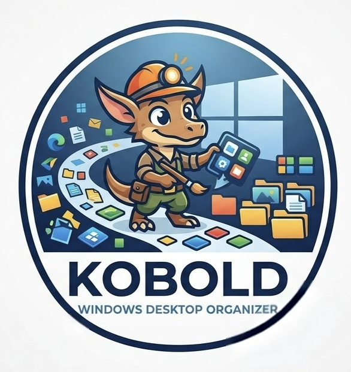
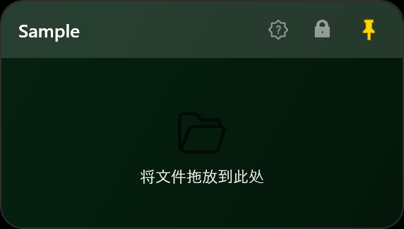
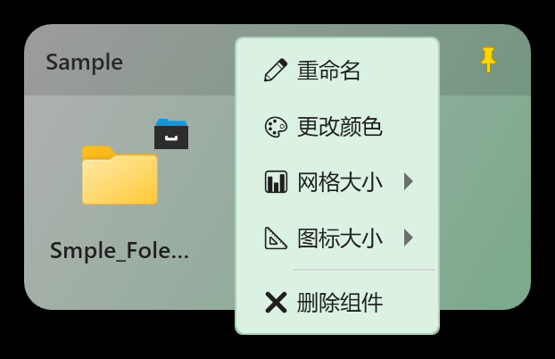
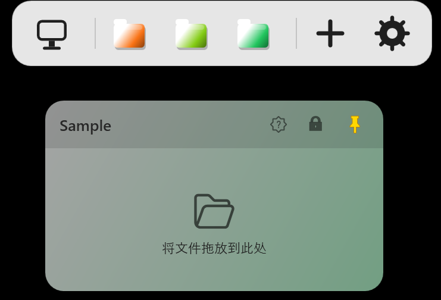

# Kobold — Windows Desktop Organizer

<div align="center">



**桌面整理小组件** | **Windows Desktop Folder Widgets**

Windows 10/11 · WPF · .NET Framework 4.8 · MIT

</div>

Kobold keeps your desktop tidy with a **dynamic-island launcher** at the
top of the screen and floating **folder panels**. Hover the island to
expand it: open the Desktop, jump into any widget, create a new one, or
open Settings — no need to hunt for the tray icon.

Built from [FoldRa](https://github.com/YusufEren97/FoldRa) as a secondary
development base.

## Features

- **Dynamic island launcher** — a slim pill at the top centre expands on
  hover into desktop / widget / add / settings entries. Click a widget
  tile to toggle its panel; drag the pill to move the island. Only the
  widget tiles scroll (a slim bar underneath hints at it) when there are
  more than fit; right-click a tile for that widget's options.
- **Folder panels** — glassy panels with per-widget colours, lock, pin and
  rename; drag any edge or the bottom-right corner to resize one freely, and
  the size is remembered per widget across restarts (a locked panel cannot be
  resized). The grid follows the panel: a wider panel spreads the icons out
  and adds a column as soon as one more fits, while a taller one only adds rows
  with the row spacing unchanged — the extra height stays at the bottom.
  **Item size** is a six-step setting in the widget menu and no longer follows
  the panel; the old per-widget **columns** / **max rows** options are gone,
  and panels no longer resize themselves with their content. Panels that were
  open when the app closed come back on the next launch, on the monitor and
  scale they were saved on, without stealing focus.
- **Folder selection in the title bar** — the panel title follows the
  selection: one entry shows its full name (the tooltip holds the whole
  path), several show **N selected**, and an empty selection falls back to
  the widget's name (or the folder being browsed). The arrow keys walk the
  grid: left/right step to the neighbouring cell across rows, up/down hold
  the column, a short last row falls to its last entry, and an edge stops —
  with nothing selected, the first arrow picks the first entry.
- **Widget kinds** — a new widget is a **folder**, a **todo** or a **note**,
  picked when you create it; all three kinds behave the same on the island, in
  panels, in the context menus and when panels come back after a restart.
- **Note widget** — a note widget is a list of cards, newest first: each card
  is a note showing its **title** (its first heading or line), when it was last
  edited, a two-line excerpt derived from the text and a `✓ 2/5`
  task-progress badge when the note holds task boxes. Click a card to read it
  (the back button or Backspace returns to the list) and **Edit** opens a
  source box with a **Source | Preview** switch. The reading view renders a
  Markdown subset — headings, lists, task boxes, quotes, code blocks, tables,
  dividers, emphasis and links (http/https links open in the browser). The
  task boxes are live: clicking one in the reading view or in the editor's
  preview ticks it back into the source, and each view keeps its scroll
  position. Right-click the source editor for a quick-insert menu (headings;
  bold / italic / strike / inline code / link; lists, task list, quote, code
  block, table, divider), whose insertions the editor's own Ctrl+Z undoes.
  Finishing commits, Esc drops the edit, a note emptied while editing is
  discarded on the way out, and Ctrl+Z takes a delete back.
- **Todo widget** — a month calendar (‹ › change the month, **Today** when
  you are on another month) over the day's list: completed entries are struck
  through and sink to the bottom. An open entry whose date is in the past
  shows up on today with a `↷ original date` badge (display only — the stored
  date never changes). Sub-todos nest one level: indented, without dates of
  their own; ticking a parent ticks all of its children, while unticking the
  parent leaves the children as they are. The panel size is entirely up to
  dragging: the calendar cell height and the day's list stretch with the
  height. In the Chinese UI a day cell's **second line** (festival / solar
  term / lunar date) shows only when the cell is tall enough. The divider
  between the calendar and the list can itself be dragged to give either half
  more room; the **+** row sticks to the bottom while the list scrolls and
  follows the last entry when there is room, and clicking it jumps the list to
  the bottom. Today wears the hand-drawn circle with a matching hand-drawn
  check tucked into its bottom-right corner.
- **Todo editing, undo & cleanup** — click a row to edit it in place: the
  insertion caret takes the widget's colour (system ink under high contrast),
  and Backspace at the very start of the text is a ladder — an open entry is
  ticked (the normal completion path: today is stamped as the completion date
  and a parent's children follow), a completed or emptied one is deleted,
  parents and sub-todos alike. Enter walks the list: a parent's editor opens
  its first sub-todo (or its sub-todo adder when it has none), a sub-todo's
  editor opens the next sibling (or its parent's adder after the last), and
  an adder keeps adding while you type; an empty Enter moves to the next
  parent's editor and ends at the bottom add box. Clicking away never jumps.
  Deletes and ticks — the row menu, the ladder, **Clear completed**, parent /
  child / ladder ticks — step back with Ctrl+Z up to 20 steps (no redo; a
  focused editor keeps its own text undo). **Clear completed**, on the list's
  or the calendar's blank space, removes the selected day's completed entries
  — a completed parent goes with its whole subtree, completed sub-todos under
  an open parent go one by one — and is greyed out when the day has none;
  Ctrl+Z brings the batch back.
- **Quiet windows** — the island and the panels stay out of Alt+Tab and Task
  View while still behaving like normal, activatable windows.
- **Steps aside for fullscreen** — while a fullscreen app or video is in
  front, the island steps out of the way and comes back when the fullscreen
  session ends.
- **Browse folders in place** — double-click a folder entry to list its
  contents inside the panel: drill in, go back (button or Backspace), open
  files with the shell. While the panel is open the listing follows the
  folder live, and the panel remembers the folder you left it in, across
  hides and restarts.
- **File actions in panels** — while browsing a folder, create, rename and
  delete (to the Recycle Bin) in place, open a terminal at the current
  folder, or fall back to the full Windows context menu (Git Bash, 7-Zip,
  properties…) via **Show more options**.
- **File clipboard while browsing** — press Ctrl+C to copy the selected
  entries, Ctrl+X to cut them, Ctrl+V to paste them into the folder on
  screen. It is Explorer's own file clipboard, so it works both ways: copy
  out of a panel and paste into an Explorer window or the desktop, or copy
  in Explorer and paste into a panel (a cut pastes as a move). A copy-paste
  never overwrites — when the name is taken, both copies are kept; a
  cut-paste collision keeps the shell's own replace prompt. Locked panels
  refuse every clipboard action.
- **File clipboard on a panel** — with items selected at a panel's root,
  Ctrl+C publishes them to the system clipboard so Explorer or another panel
  can paste them; Ctrl+V adds the clipboard's files to the panel as
  **references** — the same rule as dropping files in: the original stays
  where it is. The root panel does not respond to Ctrl+X.
- **New File dialog** — the panel's empty-area **New File** entry and the
  browse menu's entry share one dialog: a name box and an editable extension
  selector with the ten common suffixes (.txt, .md, .json, .csv, .log,
  .html, .xml, .ini, .bat, .ps1; a custom single-segment extension can be
  typed) plus a live **Will create** preview of the final name. A name that
  already ends with the suffix is not doubled; the dialog follows the
  widget's colour; the file is created empty under exactly the previewed name
  (no Windows templates). The browse menu's old **New Text Document** entry
  is now this **New File**.
- **Folder colors** — right-click a folder in a panel and give it one of nine
  colors: the icon changes everywhere (Explorer included), and **Default
  color** puts the system icon back.
- **Drag & drop everywhere** — drop files from Explorer onto a panel,
  reorder entries with a drop indicator, move them between widgets, or drag
  them out. Windows performs the move, so dropping an entry into an Explorer
  window or onto the desktop really relocates the file — collision prompts
  and progress are the shell's own.
- **Move files between panels** — browse a folder in two panels and drag
  entries from one into the other: the files move into the folder on screen.
- **Drop into a folder** — while browsing, drop entries onto any folder
  entry to move them inside, or hold Ctrl to copy them; dropping them on the
  **Back** button moves them up to the parent folder. Locked panels refuse
  the drop.
- **Readable badges** — a coloured cabinet badge means the file lives in
  Kobold storage; a grey `!` means the source was deleted or moved.
- **Safe by design** — ejecting or unstoring moves files back to their
  original location; nothing is trapped inside a widget.
- **Desktop icons toggle** — single-click the island's desktop entry to
  hide/show desktop icons, double-click to open the Desktop folder.
- **Theming** — dark/light applies to every surface (panels, island,
  settings, menus, tooltips); context menus pick up their widget's colour;
  with Windows high contrast on, every surface follows the system colours.
- **Slim scrollbars, rounded menus** — every scrollbar is a thin pill: an
  8 px hit area, a 4 px resting thumb that grows to 6 px and darkens while
  hovered or dragged, and no track arrows. Context menus share one rounded,
  airy surface — 12 px corners, an inset pill hover, a thin chevron for
  submenus, and disabled entries at half opacity — still tinted with their
  widget's colour.
- **Three languages** — English, 简体中文, 日本語.
- **Tray + startup** — tray menu for add / show all / hide all / settings
  / exit, single-instance guard and optional auto-start with Windows.
- **Idle memory trim** — after two minutes without interaction the app hands
  its working set back to Windows: the Task Manager figure drops to a few MB
  while idle, and the pages fault back in on demand.
- **DPI aware** — PerMonitorV2, verified at 200% scaling.

## Screenshots

<p align="center">
  
  <br/>
  <sub>The island expands on hover: Desktop entry, widget tiles, add-widget and settings.</sub>
</p>

<p align="center">
  
  &nbsp;&nbsp;
  
  <br/>
  <sub>A folder panel, and the widget menu that follows its colour.</sub>
</p>

<p align="center">
  
  <br/>
  <sub>The same widget in light theme.</sub>
</p>

## Install

1. Download the latest `Kobold-v*-win-x64.zip` from
   [Releases](https://github.com/zzrqq-worklux/Kobold/releases).
2. Extract it anywhere and run `Kobold.exe` — the portable way. Or run
   `tools\install.cmd` to install it for the current user: the app goes to
   `%LocalAppData%\Programs\Kobold`, with a Start Menu shortcut and an
   uninstall entry. No admin rights needed.
3. Windows 10/11 with .NET Framework 4.8 (bundled with Windows 10 1903+
   and Windows 11).
4. The build is unsigned — SmartScreen (or an antivirus) may warn on first
   run ("More info" → "Run anyway").

### Update

Extract the new zip over the old folder, or run `tools\install.cmd` again on an
installed copy: it stops the running instance, replaces the files and starts
the new version. Settings and stored files are kept.

### Uninstall

- Installed copy: **Settings → Apps → Kobold → Uninstall**, or run
  `uninstall.cmd` in the install folder (it is `tools\uninstall.cmd` in the
  zip). The script also works as a cleanup for a portable copy that was
  deleted by hand: it removes the leftover autostart entry and nothing else
  that isn't yours.
- Your data is kept by default. `%AppData%\Kobold` holds `config.json`
  (settings — safe to delete), `Storage\` (**your files** — they were moved
  there, not copied) and `FolderIcons\` (what your coloured folders point at).
  The uninstaller lists all three and asks before deleting anything.

## Usage

| Action | How |
|---|---|
| Open/close a widget panel | Hover the island, click a widget tile |
| Add a widget | Island `+` entry (or tray menu) |
| Add a todo widget | Island `+` entry (or tray menu) → choose **Todo** |
| Select a day | Click a day in the calendar (a grey day from another month switches the month first) |
| Add a sub-todo | Right-click a todo entry → **Add sub-todo** (a typed Enter adds the next one, an empty Enter moves on) |
| Tick a parent todo | Ticking it ticks all of its sub-todos; unticking it leaves them alone |
| Undo a delete or a tick | With no editor focused, Ctrl+Z steps back up to 20 edits |
| Clear the day's completed todos | Right-click the list or the calendar's blank space → **Clear completed** (greyed out when the day has none) |
| Create a note | Island `+` entry (or tray menu) → **Note**; or the panel's `+` row |
| Read a note | Click a card (Backspace / back returns) |
| Tick a task in a note | Click the box in the reading or preview view |
| Insert Markdown fast | Right-click the source editor |
| Open settings | Island gear entry (or tray menu) |
| Hide/show desktop icons | Click the island's desktop entry |
| Open the Desktop folder | Double-click the island's desktop entry |
| Browse a folder inside a panel | Double-click a folder entry (Backspace goes back, ▾ lists the whole path) |
| Move the selection with the arrow keys | Left/right cross rows, up/down keep the column, an edge stops |
| File actions in a panel | Right-click an item or the empty area (F5 refreshes, Enter opens, Shift+F10 opens the menu) |
| Create a file | Right-click the empty area or the browse background → **New File** (name + extension picker + a **Will create** preview) |
| Color a folder | Right-click a folder entry → **Folder color** (nine colours, or **Default color** to undo) |
| The full Windows context menu | Choose **Show more options** at the bottom of the panel menu |
| Preview the selected item | Select an item, press Space (QuickLook) |
| File actions (open, rename, store, eject…) | Right-click an item in a panel |
| Move a file into another folder | Drag the entry from one browse panel into another — the shell moves it, Explorer-style |
| File clipboard while browsing | Select entries, then Ctrl+C / Ctrl+X / Ctrl+V into the folder on screen (the clipboard is shared with Explorer; copies keep both on a name clash) |
| File clipboard on a panel | Ctrl+C publishes the selection to the system clipboard; Ctrl+V adds the clipboard's files as references (the root panel ignores Ctrl+X) |
| Move entries into a subfolder | While browsing, drag them onto a folder entry (hold Ctrl to copy), or onto the Back button to move them up one level |
| Move a file out to Explorer / the desktop | Drag the entry out of the panel — Windows performs the move |
| Resize a panel | Drag any edge, or the bottom-right grip (locked panels cannot be resized) |
| Move the calendar / list split | Drag the divider between the calendar and the day list (locked panels cannot) |
| Change the folder icon size | Right-click a folder panel → **Item Size** (six steps) |
| Widget options (rename, colour, lock, icon size, delete) | Right-click a panel header or an island tile |

Stored vs. referenced files: dropping a file in creates a *reference* — the
original stays where it is. **Store** in the item menu physically moves it
into Kobold storage; **Unstore** or **Eject** puts it back. Dragging an item
*out* of a panel hands the files to Windows: a target that accepts the drop
moves them for real, and a drop nothing accepts restores the item
(references become visible again, stored files return to where they came
from).

## Build & test

Requires the .NET SDK (8.x) on Windows.

```powershell
dotnet build Kobold.csproj -c Release
# -> bin\Release\net48\Kobold.exe
```

Run the console self-checks through one entry point - it runs every selected
check, prints a summary and exits non-zero when anything fails:

```powershell
powershell -NoProfile -ExecutionPolicy Bypass -File tools\Run-Checks.ps1 -Group all
powershell -NoProfile -ExecutionPolicy Bypass -File tools\Run-Checks.ps1 -List   # show the matrix
```

`checks` = every console self-check, `ci` = the subset that runs on GitHub
runners (the window/desktop-heavy checks stay local), `installer` = the
installer self-check (logic only, temp folders, no registry writes) and
`all` = checks + installer.

A GitHub Actions workflow runs the `ci` group on every push whose HEAD commit
mentions `[ci]` (or on manual dispatch), keeping runner usage deliberate.

End-to-end install/uninstall is verified by a one-off manual drill before a
release (it writes a real uninstall entry and a shortcut).

Package a release zip; the version defaults to the one in `Kobold.csproj`:

```powershell
powershell -NoProfile -ExecutionPolicy Bypass -File tools\package.ps1
```

Release notes come from `CHANGELOG.md`, and a missing version section is a hard
error - a release cannot go out without changelog entries:

```powershell
powershell -NoProfile -ExecutionPolicy Bypass -File tools\release-notes.ps1 -Version 1.2.0
# -> prints the notes, or write them with -OutFile notes.md
```

## Data

- Config: `%AppData%\Kobold\config.json` (auto-backup as `config.json.backup`).
  A config file that could not be read is first kept aside as
  `config.json.failed-<timestamp>` before defaults are used.
- Widgets are stored in the new `Widgets` format, which older releases cannot
  read: falling back to v1.3.0 or v1.3.1 resets you to default settings but
  keeps the original file aside as `config.json.failed-<timestamp>`. Releases
  older than v1.3.0 do not have that safety net. An unknown kind is kept, not
  dropped: v1.4.0 reads a config with a note in it as an unknown kind and
  hands it back unchanged, so the note is still there on the way back.
- Each widget's **panel size is saved with the widget**, so panels come back
  the size you left them. On upgrade the old per-widget columns / max-rows
  settings are converted **once** into an initial panel size (they stay in the
  config file but are no longer used); **item size** keeps working.
- Stored files: `%AppData%\Kobold\Storage`

Source layout: `Core/` (models, config, localization, design tokens,
theme manager), `Controls/` (island + folder widget windows),
`Windows/` (settings), `Helpers/` (dialogs, menus, animation, cursors),
`Themes/` (XAML control styles), `Services/` (tray, shell integration,
terminal, memory trim), `tests/` (console checks).

## Credits & License

Derived from [FoldRa](https://github.com/YusufEren97/FoldRa) by
[Yusuf Eren Seyrek](https://github.com/YusufEren97) and
[Mehmet Delin](https://github.com/Deleny), licensed under the MIT License.
This project keeps the MIT license; see the original repository for
upstream history. Kobold's own license is in [LICENSE](LICENSE); the
third-party components it ships with are listed in
[THIRD-PARTY-NOTICES.md](THIRD-PARTY-NOTICES.md).

---

# 中文说明

Kobold 是基于 [FoldRa](https://github.com/YusufEren97/FoldRa) 的二次开发项目：
顶部有一颗**灵动岛启动器**，桌面上悬浮着**文件夹面板**。鼠标悬停岛即可展开，
打开桌面、进入任意组件、新建组件或打开设置，不必再翻托盘图标。

## 功能

- **灵动岛启动器** — 屏幕顶部中央的胶囊，悬停展开为「桌面入口 / 组件 / 新建 / 设置」；
  点击组件 tile 开合面板，按住胶囊可拖动整颗岛的位置。组件多了只在中间区域滚动
  （下方细条提示可见比例），右键 tile 可直接打开该组件的选项菜单。
- **文件夹面板** — 毛玻璃半透明面板，支持每个组件自定义颜色、锁定、置顶与重命名；
  拖动任意边缘或右下角手柄即可自由缩放，尺寸属于该组件、重启后恢复，锁定的面板
  不可缩放。网格随尺寸自适应：变宽会拉开图标间距、能多放一列时自动加列；拉高只
  加行、行距不变（多出的高度留在下方）。**图标大小**是组件菜单里的六档设置，不再
  随面板变化；组件菜单里旧的**列数 / 最大行数**选项已移除，面板也不再随内容自动
  收放。退出时开着的面板会在下次启动时按原屏幕与缩放自动恢复，且不抢焦点。
- **文件夹标题栏与方向键选择** — 选中条目时标题栏显示该条目的全名（Tooltip 是完整路径），
  多选显示「N 项已选」，没有选择时回落为组件名（浏览时是当前文件夹名）；方向键按网格
  移动选择——左右跨行走到相邻格、上下保持同列，最后一行不满时向下落到最后一项，边界
  停住（未选中任何条目时，第一次方向键选中最前一项）。
- **组件类型** — 新建组件时可选「文件夹」「待办」或「笔记」三种类型；三类组件在岛、
  面板、右键菜单与开机恢复中的行为一致。
- **笔记组件** — 笔记是卡片列表，最近编辑在最上：每张卡片显示**标题**（取第一个标题行
  或首行）、最后修改时间与两行摘要（摘要由正文自动得出），有任务框时还显示 `✓ 2/5`
  完成进度。单击卡片进入阅读态（返回按钮或 Backspace 回列表），「编辑」打开源码框并带
  「源码 / 预览」切换。阅读态渲染 Markdown 子集——标题、列表、任务框、引用、代码块、
  表格、分割线、强调与链接（http/https 可在浏览器打开）。任务框可点：阅读态或编辑器
  预览态点击都会回写源码，并保持各自的滚动位置。在源码编辑器中右键是快速插入菜单
  （标题；粗体 / 斜体 / 删除线 / 行内代码 / 链接；列表、任务列表、引用、代码块、表格、
  分割线），插入用编辑器自带的 Ctrl+Z 撤回。完成即提交，Esc 放弃本次编辑，编辑中清空的
  笔记离场时丢弃，删除可用 Ctrl+Z 找回。
- **待办组件** — 月历（‹ › 换月、不在本月时显示「今天」）加当日清单：
  完成的条目划线置底。未完成且日期已过的条目会显示在今天，并带
  「↷ 原日期」角标（只影响显示，不改数据）。支持一层子待办：缩进、没有
  独立日期；勾选父项会同时勾选全部子项，取消父项不影响子项。面板尺寸完全由拖动
  决定——日历格高与当日清单随高度伸缩；中文界面下日期格的第二行（节日 / 节气 /
  农历）只在格子足够高时显示。月历与清单之间的**分隔线也可拖动**，两部分占比随意
  调整；空间不足时「＋」添加行贴在面板底部（清单滚动），够用时跟在最后一条 todo
  下方，点击它自动滚动到清单底部；今天的日期标记是手绘圈 + 右下角手绘 ✅。
- **待办编辑、撤回与清理** — 点击条目即可就地编辑：插入光标跟随组件颜色（高对比度回落
  系统文本色）；光标在文本最前（无选区）按退格是一道阶梯——未完成 → 打勾（与正常勾选
  一致：盖完成日期、父项级联子项），已完成或框内已清空 → 删除，父项与子项规则一致。
  Enter 可一路走到底：父项编辑器进第一个子项（没有子项则进它的子项添加框），子项编辑器
  进下一个兄弟（最后一个则进该父项的添加框），添加框有输入就连续添加；空 Enter 跳到
  下一个父项的编辑器，最后一个父项落到底部新增输入。点到别处不会跳行。删除与勾选（行菜单、
  退格阶梯、「清理已完成」整批、父项 / 子项 / 阶梯打勾）都能用 Ctrl+Z 按步撤回，最多
  连续回退 20 步（编辑器聚焦时仍是文本框自带的文字撤回；没有重做）。在清单或日历空白处
  右键 →「清理已完成」：清掉当前选中日的已完成条目（已完成的父项整条含子树；未完成父项
  下的已完成子项逐条删除），当天没有已完成项时置灰；整批可 Ctrl+Z 找回。
- **安静窗口** — 岛与面板不出现在 Alt+Tab / 任务视图里，同时仍是可正常激活的窗口。
- **全屏自动让路** — 前台是全屏游戏或视频时岛自动让开，退出全屏后恢复。
- **面板内浏览文件夹** — 双击组件里的文件夹条目即可在面板内就地查看其内容：
  逐级下钻、返回（按钮或 Backspace）、文件交给系统默认程序打开。
  面板打开时列表会实时跟随该文件夹的变化；面板会记住你离开时所在的文件夹，
  收起再打开、重启之后都还在。
- **面板内文件操作** — 浏览目录时可就地新建、重命名、删除（进回收站），
  一键在当前目录打开终端；需要时用「显示更多选项」调出完整的系统右键菜单
  （Git Bash、7-Zip、属性等）。
- **浏览时的文件剪贴板** — 浏览目录时按 Ctrl+C 复制选中条目、Ctrl+X 剪切、
  Ctrl+V 粘贴到当前文件夹。剪贴板就是资源管理器自己的文件剪贴板：从面板复制可
  粘到资源管理器窗口或桌面，从资源管理器复制也可粘进面板（剪切粘贴即移动）。
  复制的粘贴永不覆盖：重名时两份都保留；剪切的粘贴重名时沿用资源管理器的
  替换提示。锁定面板一律拒绝这些操作。
- **主面板文件剪贴板** — 选中条目后按 Ctrl+C 把它们发布到系统剪贴板，资源管理器
  或其他面板可直接粘贴；Ctrl+V 把剪贴板里的文件**加为引用**到面板——与拖入
  相同，源文件原地不动。主面板不响应 Ctrl+X。
- **新建文件对话框** — 面板空区的「新建文件」与浏览菜单里的「新建文件」共用同一个
  对话框：名称框 + 可编辑的后缀选择器（常用 .txt、.md、.json、.csv、.log、.html、
  .xml、.ini、.bat、.ps1，也可输入自定义的单个后缀），下方是实时的「将创建」预览；
  名称已带相同后缀不会重复追加；对话框跟随组件颜色；文件按预览的名称创建为
  **空文件**（不套用 Windows 模板）。浏览菜单原来的「新建文本文档」更名为
  「新建文件」。
- **文件夹颜色** — 右键面板里的文件夹，可给它换 9 种颜色中的一种：图标会在所有
  地方（包括资源管理器）生效；「恢复默认颜色」可还原系统图标。
- **处处拖拽** — 从资源管理器拖文件进面板；拖动条目显示插入指示线、可跨组件移动；
  拖出面板即交给系统：拖进资源管理器窗口或桌面就是真正移动文件，冲突提示与进度
  都是系统原生的。
- **面板之间移动文件** — 两个面板各浏览一个文件夹，把一个面板里的条目拖进另一个，
  文件就会移动进对方正在显示的文件夹。
- **拖入文件夹** — 浏览时把条目拖到任意文件夹条目上即可移入该文件夹，按住 Ctrl
  为复制；拖到「返回」按钮则移回上级目录。锁定面板拒绝该操作。
- **一眼看懂的角标** — 彩色文件柜角标 = 文件已收纳进 Kobold 存储；灰色 `!` =
  源文件已被删除或移动。
- **安全回收** — 移除或取消收纳时，文件都会移回原位置，不会被困在组件里。
- **桌面图标开关** — 单击岛的桌面入口隐藏/显示桌面图标，双击打开桌面文件夹。
- **主题** — 深色/浅色覆盖所有界面（面板、岛、设置、菜单、Tooltip）；
  右键菜单会带上所属组件的颜色；系统开启高对比度时界面跟随系统色。
- **细胶囊滚动条与圆润菜单** — 全局滚动条都是细胶囊：点击区 8px，静止时是 4px 圆角
  胶囊、悬停或拖动时 6px 并加深，没有轨道与箭头；右键菜单统一为圆润留白样式——圆角 12、
  内缩胶囊悬停、细人字子菜单箭头、禁用项 0.5 置灰，仍带所属组件的颜色淡染。
- **三语界面** — English / 简体中文 / 日本語。
- **托盘与自启** — 托盘菜单提供新建、显示全部、隐藏全部、设置与退出；
  单实例保护，可选开机自启。
- **空闲内存回收** — 静置两分钟无操作后把工作集交还给系统：任务管理器内存
  降到个位数 MB，需要时自动换页回来。
- **DPI 友好** — PerMonitorV2，200% 缩放下已验证。

> 界面预览见上方 [Screenshots](#screenshots)（灵动岛 / 深色面板 / 右键菜单 / 浅色主题）。

## 安装

1. 从 [Releases](https://github.com/zzrqq-worklux/Kobold/releases) 下载最新的 `Kobold-v*-win-x64.zip`。
2. 解压到任意目录，运行 `Kobold.exe`（免安装）；或运行 `tools\install.cmd`
   为当前用户安装：程序装到 `%LocalAppData%\Programs\Kobold`，带开始菜单
   快捷方式与卸载项，无需管理员权限。
3. 需要 Windows 10/11 与 .NET Framework 4.8（Win10 1903+ 与 Win11 自带）。
4. 构建未签名，首次运行 SmartScreen（或杀毒软件）可能提示（「更多信息」→「仍要运行」）。

### 更新

把新 zip 解压覆盖旧目录即可；已安装的副本再跑一次 `tools\install.cmd`：
它会停掉正在运行的实例、替换文件并启动新版本，设置与收纳的文件都保留。

### 卸载

- 已安装副本：**设置 → 应用 → Kobold → 卸载**，或运行安装目录里的
  `uninstall.cmd`（zip 里是 `tools\uninstall.cmd`）。该脚本也能清理
  「手动删了便携版文件夹」的残留：只删属于它的自启项，不动别的东西。
- 默认保留你的数据。`%AppData%\Kobold` 里有 `config.json`（设置，删了无害）、
  `Storage\`（**你的文件**——是被移进来的，不是复制）和 `FolderIcons\`
  （上过色的文件夹指向这里）。卸载器会把三者列出来，删任何东西前先问你。

## 用法

| 操作 | 方式 |
|---|---|
| 打开/收起组件面板 | 悬停岛，单击组件 tile |
| 新建组件 | 岛的 `+` 入口（或托盘菜单） |
| 新建待办 | 岛的 `+` 入口（或托盘菜单）→ 选择「待办」 |
| 选中日期 | 点击月历中的日期（非本月的格子会先切月） |
| 添加子待办 | 右键待办条目 →「添加子项」（有输入时 Enter 继续添加，空 Enter 跳到下一个父项） |
| 勾选级联 | 勾选父项会同时勾选其全部子项；取消勾选父项不影响子项 |
| 撤回删除或勾选 | 编辑器未聚焦时按 Ctrl+Z，最多连续回退 20 步 |
| 清理当天已完成 | 在清单或日历空白处右键 →「清理已完成」（当天没有已完成项时置灰） |
| 新建笔记 | 岛的 `+` 入口（或托盘菜单）→ 选择「笔记」；或面板顶部的 `+` 行 |
| 阅读笔记 | 单击卡片（Backspace / 返回按钮退回列表） |
| 勾选笔记中的任务框 | 在阅读态或编辑器预览态点击方框 |
| 快速插入 Markdown | 在源码编辑器内右键 |
| 打开设置 | 岛的齿轮入口（或托盘菜单） |
| 隐藏/显示桌面图标 | 单击岛的桌面入口 |
| 打开桌面文件夹 | 双击岛的桌面入口 |
| 在面板内浏览文件夹 | 双击文件夹条目（Backspace 返回上一级，▾ 展开整条路径） |
| 方向键移动选择 | 左右跨行、上下同列，到边界停住 |
| 面板内文件操作 | 右键条目或空白处（F5 刷新、Enter 打开、Shift+F10 弹菜单） |
| 新建文件 | 右键空白处或浏览背景 →「新建文件」（名称 + 后缀选择器 +「将创建」预览） |
| 给文件夹上色 | 右键文件夹条目 →「文件夹颜色」（9 种颜色；「恢复默认颜色」可还原） |
| 完整系统右键菜单 | 面板菜单底部的「显示更多选项」 |
| 快速预览选中项 | 选中条目后按空格（需安装 QuickLook） |
| 文件操作（打开、重命名、收纳、移出…） | 右键面板中的条目 |
| 把文件移到另一个文件夹 | 从一个浏览面板拖到另一个浏览面板——由系统执行移动，和资源管理器一致 |
| 浏览时的文件剪贴板 | 选中条目后 Ctrl+C 复制、Ctrl+X 剪切、Ctrl+V 粘贴到当前文件夹（与资源管理器互通；复制重名保留两份） |
| 主面板文件剪贴板 | Ctrl+C 发布选中项到系统剪贴板；Ctrl+V 把剪贴板中的文件加为引用（主面板不响应 Ctrl+X） |
| 把条目移入子文件夹 | 浏览时拖到文件夹条目上（按住 Ctrl 为复制）；拖到「返回」按钮则移回上级目录 |
| 把文件拖到资源管理器 / 桌面 | 把条目拖出面板——由系统执行移动 |
| 调整面板大小 | 拖动任意边缘或右下角手柄（锁定的面板不可缩放） |
| 调整月历 / 清单占比 | 拖动月历与清单之间的分隔线（锁定不可拖） |
| 修改文件夹图标大小 | 右键文件夹面板 →「📐 图标大小」（六档） |
| 组件选项（改名、改色、锁定、图标大小、删除） | 右键面板标题栏或岛上的组件图标 |

拖入的文件默认是**引用**（源文件原地不动）；在条目菜单里选择「收纳」才会真正
移入 Kobold 存储，「取消收纳」或「移出」会放回原位置。把条目拖出面板则交给系统：
落点接受就真的移动文件；落点不收（例如不支持文件的窗口）按原规则还原——
引用重新可见、收纳项搬回原位置。

## 构建与测试

需要 Windows + .NET SDK（8.x）：

```powershell
dotnet build Kobold.csproj -c Release
# 产物：bin\Release\net48\Kobold.exe
```

`tests/` 下是控制台自检，通过一个入口运行（逐项执行、汇总结果、失败非零退出）：

```powershell
powershell -NoProfile -ExecutionPolicy Bypass -File tools\Run-Checks.ps1 -Group all
powershell -NoProfile -ExecutionPolicy Bypass -File tools\Run-Checks.ps1 -List   # 只看矩阵
```

`checks` = 全部控制台自检；`ci` = 可在 GitHub runner 上运行的保守子集（依赖真实桌面
会话的检查留在本地）；`installer` = 安装器纯逻辑自检（只在临时目录，不写注册表）；
`all` = 两者之和。

GitHub Actions 工作流在 HEAD 提交信息含 `[ci]`（或手动触发）时运行 `ci` 组，
避免每次 push 都消耗 runner。

端到端安装/卸载由发布前的一次性人工演练覆盖（会写真实的卸载注册表项与快捷方式）。

打包发布 zip，版本号默认读 `Kobold.csproj`（单一真源）：

```powershell
powershell -NoProfile -ExecutionPolicy Bypass -File tools\package.ps1
```

Release 正文从 `CHANGELOG.md` 生成；缺少对应版本小节会直接报错——不让没有更新
日志的版本发布：

```powershell
powershell -NoProfile -ExecutionPolicy Bypass -File tools\release-notes.ps1 -Version 1.2.0
# 输出正文；用 -OutFile notes.md 写入文件
```

## 数据目录

- 配置：`%AppData%\Kobold\config.json`（自动备份为 `config.json.backup`）。
  读不出的配置文件会先保留为 `config.json.failed-<时间戳>`，再退回默认设置。
- 组件以新的 `Widgets` 格式保存，旧版本读不出该格式：回退到 v1.3.0 / v1.3.1
  会以默认设置启动，并把原配置文件保留为 `config.json.failed-<时间戳>`；更早的
  版本没有这一保护。格式里的未知类型不会被丢掉：v1.4.0 读到含笔记的配置会按
  未知类型原样保留，回到新版本时笔记仍在。
- 每个组件的**面板尺寸随组件保存**，重启后恢复；升级时旧的组件级「列数 / 最大
  行数」会**一次性换算**为初始面板尺寸（旧值仍保留在配置文件里但不再使用）；
  **图标大小**继续生效。
- 收纳文件：`%AppData%\Kobold\Storage`

源码结构：`Core/`（模型、配置、本地化、设计令牌、主题管理）、`Controls/`（岛与组件窗口）、
`Windows/`（设置）、`Helpers/`（弹窗、菜单、动画、光标）、`Themes/`（XAML 控件样式）、
`Services/`（托盘、Shell 集成、终端、内存回收）、`tests/`（控制台自检）。

## 许可

上游 [FoldRa](https://github.com/YusufEren97/FoldRa)（作者 Yusuf Eren Seyrek、
Mehmet Delin）为 MIT 协议，本项目沿用 MIT 协议。Kobold 自身的许可全文见
[LICENSE](LICENSE)，随包分发的第三方组件见 [THIRD-PARTY-NOTICES.md](THIRD-PARTY-NOTICES.md)。
